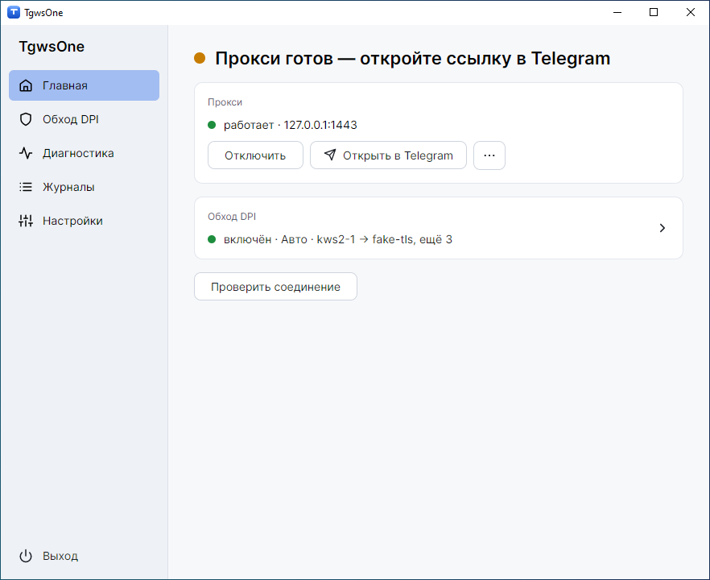
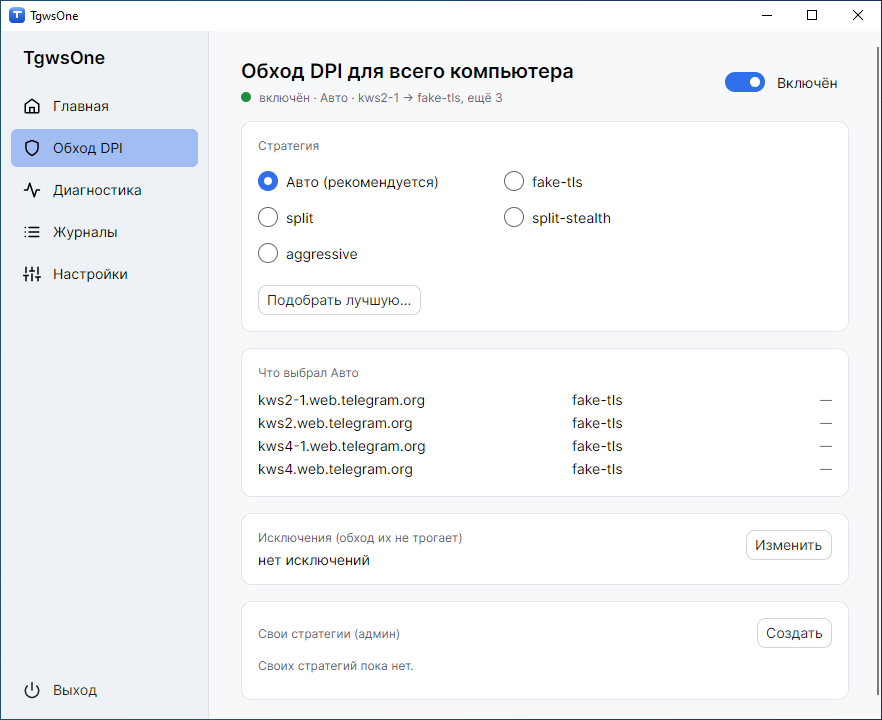
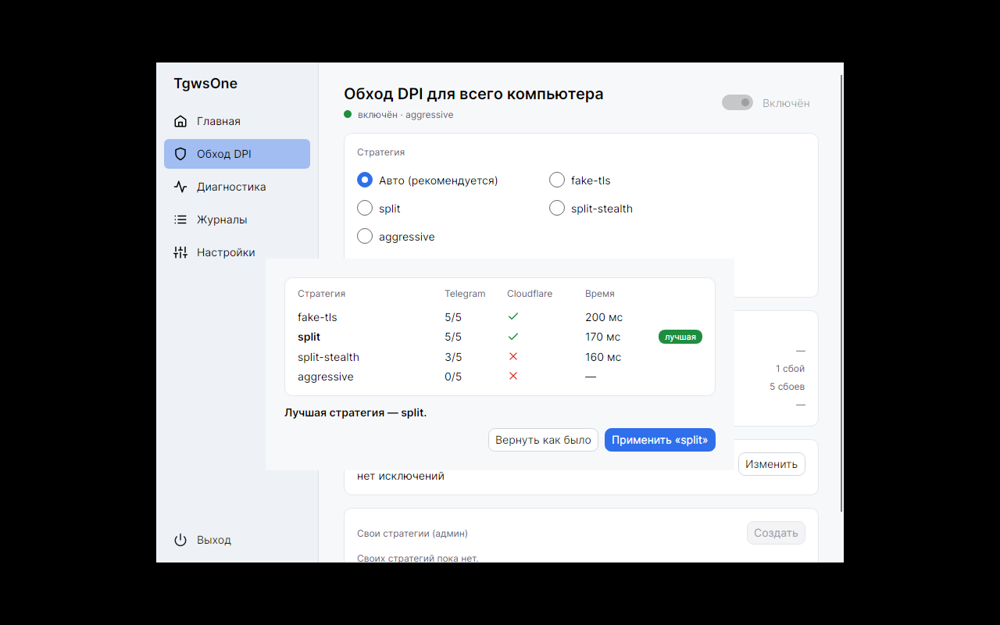
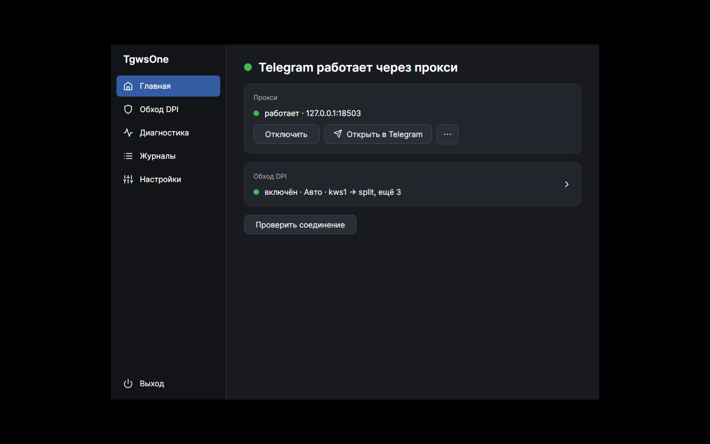

# TgwsOne — прокси для Telegram и обход DPI в одном приложении

Локальный MTProto-прокси для Telegram Desktop (нативный движок на C# по мотивам [tg-ws-proxy](https://github.com/Flowseal/tg-ws-proxy)) и
обход DPI на [zapret2](https://github.com/bol-van/zapret2) — с окном, треем и установщиком для **Windows** и **Linux**.

```
Telegram Desktop
      │  MTProto, 127.0.0.1:1443                     WebSocket / TLS
      ▼                                         ┌──────────────────────────┐
┌──────────────────────────┐ ──────────────────►│ дата-центры Telegram     │
│ TgwsOne (пользователь)   │                    │ (kws*.web.telegram.org)  │
│ окно · трей · движок C#  │   CF-прокси, HTTP/2├──────────────────────────┤
│ прокси                   │ ──────────────────►│ Cloudflare               │
└───────────┬──────────────┘                    └──────────────────────────┘
            │ локальный канал (pipe / Unix-сокет)          ▲
            ▼                                              │ TLS ClientHello
┌──────────────────────────┐                               │ обрабатывает zapret2
│ служба обхода DPI        │  winws2 + WinDivert (Windows) │
│ SYSTEM / root,           │  nfqws2 + nftables (Linux) ───┘
│ одна на компьютер        │
└──────────────────────────┘
```



Все снимки экрана: [Windows](docs/images/windows/) и [Linux, светлая и тёмная тема](docs/images/linux/).

## Что умеет

- **Одна кнопка «Подключить»** запускает прокси и включает обход DPI. Вверху окна — одна фраза о состоянии:
  «Telegram работает через прокси», «Прокси готов — откройте ссылку в Telegram» или что сломалось.
- **Обход DPI в режиме «Авто»**: zapret2 сам подбирает для каждого узла одну из четырёх стратегий и переключается,
  если соединения обрываются. На странице «Обход DPI» видно, какую стратегию «Авто» выбрал для какого узла.
- **Подбор стратегии**: приложение по очереди пробует стратегии, проверяет TLS до серверов Telegram и скачивание
  64 КБ через Cloudflare и показывает таблицу с лучшей.
- **Диагностика с вердиктом**: семь проверок (движок, прокси, подключение Telegram, служба обхода, TCP и TLS до
  серверов Telegram, Cloudflare) и вывод простыми словами с кнопкой исправления.
- **Обход по умолчанию — только для Telegram**: затрагивает ровно тот трафик, что идёт через прокси, — хосты Telegram
  и узлы запасного пути за Cloudflare (`kws<dc>.<домен>` из `lists/cfproxy-domains.txt`). Галочка
  «Применять и к остальным приложениям» на странице «Обход DPI» расширяет его на все адреса Cloudflare (браузеры и прочее).
- **Исключения** — сайты и адреса, которых обход не касается, — правит любой пользователь прямо в приложении.
- **Свои стратегии** на Lua для zapret2 — с проверкой перед сохранением; сохраняет администратор.
- **Телефон в той же сети**: прокси можно открыть для домашней сети и подключить телефон по QR-коду.
- **Мастер первого запуска**, автозапуск при входе, значок в трее, уведомления о сбоях, светлая и тёмная тема.
- **Администратор ставит один раз — пользователь работает без прав администратора**: обходом владеет служба,
  а приложение управляет ею через локальный канал, без UAC и пароля.



| Подбор стратегии (Linux) | Тёмная тема (Linux) |
|---|---|
|  |  |

## Как это устроено

- **Прокси** у каждого пользователя свой: движок MTProto-over-WebSocket встроен в приложение, работает от имени
  пользователя и слушает `127.0.0.1:1443` (если порт занят — следующий свободный, и приложение просит открыть ссылку заново).
- **Обход DPI** — один на компьютер: служба (`TgwsOneZapret` в Windows, `tgwsone-zapret` в systemd) запускает
  winws2 / nfqws2, перезапускает его при сбое и перед применением проверяет каждую стратегию (`--dry-run`).
  Обход касается только TLS на порт 443 к серверам Telegram и к подсетям Cloudflare.
- Приложение говорит со службой командами `status`, `on`, `off`, `use`, `strategies`, `exclusions`. Свою стратегию
  может сохранить только администратор: это код, который выполняется с правами системы.

## Установка

### Windows 10 (1809 и новее) и 11, x64

1. Администратор запускает `TgwsOne-2.0.0.msi` (тихо: `msiexec /i TgwsOne-2.0.0.msi /qn`). Ставятся программа,
   служба обхода DPI и правило брандмауэра для подключения телефона (только частная сеть, только своя подсеть).
2. Пользователь — в том числе без прав администратора — открывает «TgwsOne» из меню «Пуск», проходит мастер
   из трёх шагов и подтверждает прокси в Telegram («Connect Proxy» / «Подключить прокси»).

Обновление с 1.x — тем же MSI поверх: 1.x удаляется, старая задача планировщика и старый `winws` убираются, порт
и секрет пользователя сохраняются. Удаление: «Параметры → Приложения» или `msiexec /x TgwsOne-2.0.0.msi /qn`.

### Linux x86_64

Архив (нужны `nftables` и `icu`; для сохранения своих стратегий из окна — `polkit`):

```sh
tar xf tgwsone-2.0.0-linux-x64.tar.gz
cd tgwsone-2.0.0
sudo ./install.sh          # в /usr/local, включает службу tgwsone-zapret
sudo ./uninstall.sh        # удалить; --purge — вместе с /etc/tgwsone, /var/lib/tgwsone и журналами
```

Arch Linux — пакет `tgwsone-bin`:

```sh
make zapret2 build dist-linux
cd dist && makepkg -si
sudo systemctl enable --now tgwsone-zapret
```

## Обход DPI: стратегии

| Стратегия | Что делает |
|---|---|
| **Авто** (по умолчанию) | `circular` из zapret2: для каждого узла начинает с `fake-tls` и после трёх сбоев за минуту переходит к следующей |
| `fake-tls` | фальшивые ClientHello с неверным номером последовательности, затем `multidisorder` |
| `split` | `multisplit` с перекрытием (seqovl 681, образец ClientHello google.com) |
| `split-stealth` | то же с перекрытием 568 и образцом vk.com |
| `aggressive` | 11 фальшивых ClientHello с `md5sig`, затем `multisplit` |

**Своя стратегия** — файл `<имя>.args` в папке стратегий службы, по одному параметру zapret2 в строке. Разрешены
`--lua-desync`, `--blob`, `--lua-init`, `--payload`, `--in-range`, `--out-range`; цели и перехват задаёт сама
служба, поэтому `--filter-*`, `--hostlist*`, `--ipset*`, `--wf-*`, `--qnum` и подобные отклоняются. Из окна:
«Обход DPI → Свои стратегии → Создать»: «Проверить» запускает `--dry-run`, «Сохранить» просит права администратора.

**Набор для оператора или релея.** Файл `<провайдер>.rotation` в той же папке перечисляет, какие встроенные
стратегии перебирает «Авто» (по одной в строке, `#` — комментарий), а ключ `provider` в `service.ini` выбирает
этот набор. Так под конкретного оператора остаются только рабочие у него стратегии, и «Авто» не тратит попытки на
остальные. Неизвестный провайдер, пустой или нечитаемый файл означают универсальный набор: опечатка не оставляет
машину без обхода.

## Маскировка (fake TLS)

С доменом в `faketls` (`TgwsOne.ini`, `[proxy]`) прокси выглядит как обычный HTTPS-сайт: ссылка выдаётся с
`ee`-секретом, клиент присылает настоящий на вид ClientHello, прокси отвечает ServerHello + ChangeCipherSpec и
дальше ведёт MTProto внутри ApplicationData-записей. Соединение проверяется по HMAC в поле random и по метке
времени, поэтому перехваченное рукопожатие не переигрывается. Всё, что не прошло проверку, уходит на маскировочный
домен; если он недоступен, клиент получает TLS alert — молчаливого обрыва, по которому зондирование отличает
прокси от сайта, больше нет. Пустой `faketls` — прежнее поведение с `dd`-секретом.

## Командная строка

| Ключ | Что делает |
|---|---|
| (без ключей) | окно приложения |
| `--tray` | подключиться и остаться в трее (так стартует автозапуск) |
| `--start` / `--stop` / `--status` | прокси без окна (`--status`: код 0 — слушает, 1 — нет) |
| `--zapret status\|on\|off\|use <стратегия>\|strategies\|exclusions` | обход DPI через службу, без прав администратора |
| `--selftest` | проверка окружения (код — число проблем) |
| `--version` | версия |
| `--service` | служба обхода (её запускают systemd и диспетчер служб Windows) |
| `--engine …` | движок прокси без окна (так `--start` поднимает его, когда приложение не запущено); ключи — как у tg-ws-proxy |

## Где что лежит

| | Windows | Linux |
|---|---|---|
| Программа | `C:\Program Files\TgwsOne` | `/usr/local/lib/tgwsone` (пакет: `/usr/lib/tgwsone`) |
| Настройки пользователя | `%LOCALAPPDATA%\TgwsOne\TgwsOne.ini` | `~/.config/tgwsone/tgwsone.ini` |
| Журналы пользователя | `%LOCALAPPDATA%\TgwsOne\logs` | `~/.local/state/tgwsone/logs` |
| Служба: состояние и исключения | `C:\ProgramData\TgwsOne` | `/var/lib/tgwsone` |
| Служба: списки целей и свои стратегии | `C:\ProgramData\TgwsOne\lists`, `…\strategies` | `/etc/tgwsone/lists`, `/etc/tgwsone/strategies` |
| Журналы службы | `C:\ProgramData\TgwsOne\logs` | `/var/log/tgwsone`, `journalctl -u tgwsone-zapret` |

## Сборка

Нужны .NET SDK 10 и `make`; для MSI — Windows с WiX 5.

```sh
make zapret2     # zapret2 v1.0.7 с проверкой контрольной суммы
make build       # приложение для Linux одним файлом → out/publish/linux-x64
make test        # тесты (в песочнице: настоящий профиль не трогают)
make test-network  # по желанию: реальный обмен с Telegram через WS-пул и Cloudflare
make dist-linux  # архив и PKGBUILD → dist/
make build-win   # приложение для Windows → out/publish/win-x64
```

MSI собирается в Windows:
`.\build.ps1 -AppDir out\publish\win-x64 -Version 2.0.0.0`
(подпись — см. [SIGNING.md](SIGNING.md)). CI (`.github/workflows/build.yml`) собирает и тестирует каждый
pull request в `main`, а по тегу `v*` выпускает релиз с MSI, архивом и PKGBUILD.

## Как проверено

- Модульные и интерфейсные тесты (`make test`), включая проверку интерфейса без экрана и тесты нативного движка
  (`tests/TgwsOne.Engine.Tests`: криптография, WebSocket, разбор пакетов, сквозной обмен через запасной TCP-путь).
  Рукопожатие obfuscated2 сверяется с векторами, вычисленными Python-библиотекой `cryptography` из оригинала.
- Нативный движок проверен на реальном Telegram: WS-пул и маршрут через Cloudflare доводят `req_pq_multi` до
  `resPQ` (`make test-network`); сами дата-центры и TLS к маскировочным доменам зависят от сети. Аргументы
  командной строки проверяются на настоящем `tgwsone --engine` (`make test-engine`, нужен `make build`).
- Служба обхода с настоящими nfqws2 и nftables — в отдельных сетевых пространствах Linux: таблица правил
  включается и выключается, стратегия применяется к ClientHello, «Авто» переключает стратегию после сбоев,
  исключения применяются без перезапуска, при падении службы трафик не рвётся.
- Сквозная проверка MTProto: обмен ключами с дата-центром Telegram и ответ на запрос — через прокси, в Linux и
  в Windows.
- Windows 10 22H2 без обновлений: установка администратором; работа обычного пользователя без прав
  (включение, выключение и смена стратегии без UAC); обход на реальном трафике; восстановление службы после
  принудительного завершения; мастер, трей, автозапуск после перезагрузки и уведомление; удаление;
  обновление с 1.0.6 с сохранением порта и секрета и обновление 2.0.0 → 2.0.1 при работающем приложении.

## Ограничения

- Проверялась механика: что обход применяется к нужным соединениям и Telegram отвечает через прокси. Насколько
  обход помогает против DPI конкретного провайдера, зависит от провайдера; если не помогает ни одна стратегия,
  нужен туннель (VPN).
- Через WebSocket-маршрут движка tg-ws-proxy часть новых соединений сбрасывается на втором запросе (поведение
  самого движка); Telegram при этом переподключается сам.
- В Windows управлять обходом можно из обычного сеанса на рабочем столе; из сеанса SSH служба команды не принимает.
- Windows: только x64. WinDivert (часть zapret2) антивирусы часто помечают как RiskTool — добавьте папку
  установки в исключения. Драйвер WinDivert общий с другими программами обхода, поэтому установщик его не
  выгружает: после удаления он остаётся загруженным до перезагрузки. Аппаратная защита стека (CET) у процесса
  выключена намеренно: иначе .NET 10 не запускается на Windows 10 без свежих обновлений.
- Обновление с 1.x при включённом в 1.x обходе не проверялось.
- Linux: архив из CI собирается на Ubuntu 22.04; на более старых дистрибутивах приложение может не запуститься (glibc).
- MSI без подписи: SmartScreen может показать «Неизвестный издатель».

## Благодарности и лицензии

- [Flowseal/tg-ws-proxy](https://github.com/Flowseal/tg-ws-proxy) — движок прокси, MIT; его логика MTProto-over-WebSocket
  перенесена на C# (`src/TgwsOne.Engine`), оригинал и версия указаны в `src/TgwsOne.Engine/UPSTREAM.md`
- [bol-van/zapret2](https://github.com/bol-van/zapret2) — обход DPI, MIT
- [WinDivert](https://github.com/basil00/WinDivert) — перехват пакетов в Windows, LGPL-3.0 / GPL-2.0
- [Avalonia](https://avaloniaui.net/), [CommunityToolkit.Mvvm](https://github.com/CommunityToolkit/dotnet),
  [QRCoder](https://github.com/codebude/QRCoder) — MIT
- [WiX Toolset](https://wixtoolset.org/) — сборка MSI, MS-RL

Код этого репозитория — MIT, см. [LICENSE](LICENSE). Сторонние компоненты распространяются на условиях своих лицензий.
