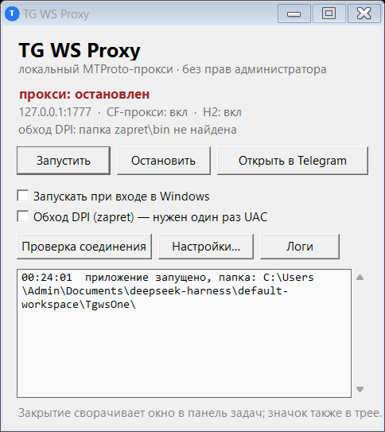
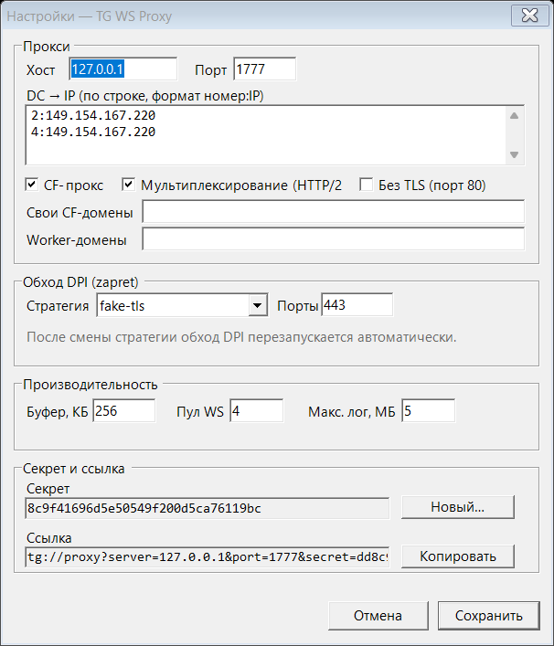

# TgwsOne — TG WS Proxy + zapret в одном приложении

Одно приложение для Windows: локальный MTProto-прокси для Telegram Desktop (движок
[TG WS Proxy](https://github.com/Flowseal/tg-ws-proxy)) плюс обход DPI через
[zapret](https://github.com/bol-van/zapret) — с графическими настройками, треем и
установщиком MSI.

```
Telegram Desktop
      │  MTProto, 127.0.0.1:1443
      ▼
┌──────────────────┐        WebSocket / TLS         ┌─────────────────────────┐
│      TgwsOne     │ ─────────────────────────────► │ дата-центры Telegram    │
│  окно + трей     │                                │ (kws*.web.telegram.org) │
│                  │        CF-прокси, HTTP/2       ├─────────────────────────┤
│  TgWsProxy       │ ─────────────────────────────► │ Cloudflare              │
└──────────────────┘                                └─────────────────────────┘
         ▲                                                      ▲
         │ локально, без прав администратора                    │ zapret (winws):
         │                                                      │ fake TLS + split,
    пользователь                                                │ только CF и Telegram
```



## Что внутри

- **Прокси без прав администратора.** Приложение работает как обычный пользователь,
  движок слушает `127.0.0.1:1443`, данные пишутся в `%LOCALAPPDATA%\TgwsOne`.
- **Обход DPI (опционально).** `winws` + WinDivert требуют прав ядра, поэтому установщик один раз
  создаёт задачу планировщика `TgwsOne-Zapret` (`RunLevel = HighestAvailable`, запуск при входе).
  Дальше включение обхода — без запросов UAC.
- **Окно настроек.** Порт и хост, таблица `DC → IP`, CF-прокси и HTTP/2, свои CF/Worker-домены,
  стратегия zapret, буфер/пул/лог, перегенерация секрета и копирование `tg://`-ссылки.



## Установка

1. Скачайте `TgwsOne-x.y.z.msi` из [Releases](../../releases).
2. Запустите, подтвердите UAC один раз. Ставится в `C:\Program Files\TgwsOne`,
   ярлыки — в меню «Пуск» и на рабочем столе.
3. Запустите приложение ярлыком → «Запустить» → «Открыть в Telegram».

Всё необходимое (движок прокси и zapret) уже внутри MSI — докачивать ничего не нужно.

Тихая установка: `msiexec /i TgwsOne-x.y.z.msi /qn`.
Удаление: «Параметры → Приложения» или `msiexec /x TgwsOne-x.y.z.msi /qn` (задача zapret удаляется).

## Где что лежит

| Что | Где |
|---|---|
| Программа, движок, zapret | `C:\Program Files\TgwsOne` |
| Настройки, списки, логи | `%LOCALAPPDATA%\TgwsOne` |
| Конфиг и лог прокси | `%LOCALAPPDATA%\TgwsOne\engine\TgWsProxy_data` |
| Задача обхода DPI | Планировщик заданий → `TgwsOne-Zapret` |

Портативный режим: если положить `TgwsOne.exe` и `TgWsProxy_windows.exe` в обычную папку
(не в Program Files), все данные пишутся рядом с программой.

## Командная строка

| Ключ | Действие |
|---|---|
| `--tray` | стартовать сразу в трей |
| `--show` | показать окно запущенного экземпляра |
| `--start` / `--stop` / `--status` | управление прокси без окна (коды: 0 — ок, 1/2 — нет) |
| `--selftest` | диагностика в `%LOCALAPPDATA%\TgwsOne\logs\selftest.log` |
| `--ensure-zapret-task` / `--remove-zapret-task` | создать/удалить задачу обхода (нужен админ) |
| `--zapret-start` | супервизор winws (запускается задачей) |

## Сборка

Нужны: .NET SDK, WiX 5 (`dotnet tool install --global wix --version 5.*`), исходники движка и zapret.

```powershell
# 1. upstream-бинарники (в репозитории их нет — лицензии и размер)
gh release download --repo Flowseal/tg-ws-proxy --pattern TgWsProxy_windows.exe -D _upstream
gh release download --repo Flowseal/zapret-discord-youtube -D _zapret
# распаковать архив zapret так, чтобы был _zapret\bin\winws.exe

# 2. сборка MSI
.\build.ps1 -Engine _upstream\TgWsProxy_windows.exe -ZapretBin _zapret\bin -Version 1.0.3.0
```

`build.ps1` компилирует `src\TgwsOne.cs` (csc из .NET Framework, без внешних зависимостей),
раскладывает staging и собирает MSI из `installer\TgwsOne.wxs`.

## Структура

```
src/TgwsOne.cs              приложение (WinForms, один файл, C# 5)
src/app.ico                 иконка (10 размеров)
installer/TgwsOne.template.wxs  шаблон описания MSI (WiX 5)
build.ps1                   сборка exe + MSI
.github/workflows/build.yml CI: сборка MSI и релиз по тегу
```

## Подпись

Сборка умеет подписывать exe и MSI: см. [SIGNING.md](SIGNING.md) (сертификаты, CI-секреты, самоподписанный вариант).

Есть готовая сборка с самоподписанным сертификатом для домена — релиз [selfsigned-1.0.5](../../releases/tag/selfsigned-1.0.5), публичная часть сертификата в [signing/](signing/README.md).

## Ограничения

- Только Windows 10/11 x64.
- WinDivert (часть zapret) часто определяется антивирусами как RiskTool — добавьте папку
  установки в исключения.
- Эффективность обхода DPI зависит от провайдера: перебирайте стратегии
  (`fake-tls`, `split`, `split-stealth`, `aggressive`) в настройках или в трее.
  Если не помогает ни одна — нужен туннель (WARP, AmneziaWG и т. п.).
- MSI не подписан сертификатом: SmartScreen может показать «Неизвестный издатель».

## Благодарности и лицензии

- [Flowseal/tg-ws-proxy](https://github.com/Flowseal/tg-ws-proxy) — движок прокси, MIT
- [Flowseal/zapret-discord-youtube](https://github.com/Flowseal/zapret-discord-youtube) — сборка zapret для Windows, MIT
- [bol-van/zapret](https://github.com/bol-van/zapret) — оригинальный zapret, MIT
- [WiX Toolset](https://wixtoolset.org/) — сборка MSI

Код этого репозитория — MIT, см. [LICENSE](LICENSE). Бинарники сторонних проектов
распространяются на условиях их собственных лицензий.
